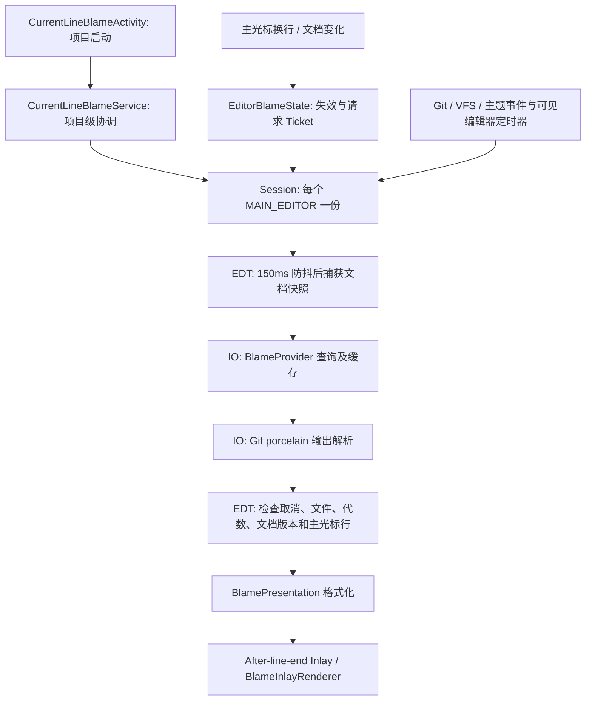

# Git Plus V1 代码审查报告

审查日期：2026-10-14（Asia/Shanghai）  
审查提交：`14fd0640fee84bdd775c14a58adebdddf0e7a86c`  
目标环境：IntelliJ IDEA **2026.3 EAP，IU-263.6800.24，macOS aarch64，JBR 25.0.4.1**。

本次只分析。未修改产品代码、测试、构建配置或 Git 状态；只新增本报告。构建、测试和复现产生的文件位于被忽略的 `build/` 或临时目录。本报告中的建议尚未实施。

## 1. 审查结论

V1 的职责划分基本清晰：项目服务协调编辑器会话，Git 查询与 UI 状态分离，行尾使用虚拟 Inlay，不修改源码。服务注入的协程作用域、Disposable 父子关系、文档版本和请求代数检查，为取消任务及拒绝过期结果提供了基础。

**当前不能将“2025.3 下测试通过”等同于“2026.3 EAP 已完成工程验证”。** 本次默认 SDK 下重新执行的 **19 个测试全部通过**，打包和结构检查通过；使用实际 2026.3 EAP SDK 编译时，因缺少 DVCS 父类依赖而失败，EAP 测试未进入执行阶段。另一方面，默认 SDK 生成的 ZIP 对该 EAP 的 Plugin Verifier 检查为 **Compatible**。这两个结果并不矛盾：前者验证源码构建路径，后者验证已有安装包的静态二进制兼容性。

需要优先讨论的事项：

1. 修复或明确 2026.3 EAP 的源码构建路径，并建立明确的 EAP 验证门禁。
2. 混合 LF/CRLF 文件会因快照序列化改变未修改行的字节内容，产生错误的“尚未提交”归属。
3. 全局 VFS 事件造成所有编辑器缓存失效；全文件解析、逐行重复提交对象及每编辑器独立缓存放大资源消耗。
4. 增加 Hover / Commit Diff 前，保留结构化的提交、仓库和历史文件上下文，避免从显示文本反向解析。

没有确认正常执行路径存在 Inlay 泄漏，也没有确认当前使用的核心 IntelliJ API 被标记为废弃。没有进行交互式 EAP 沙盒的主题、软换行、关闭项目或动态卸载验收。

### 严重程度与证据口径

| 等级 | 本报告含义 |
| --- | --- |
| P1 | 阻塞目标开发/构建路径，应优先处理；不自动等于已有 ZIP 无法运行 |
| P2 | 正确性、显著资源消耗或并发风险，应在扩展功能前处理或明确边界 |
| P3 | 较小的重复开销、诊断或条件性清理问题 |

“已确认”指源码直接证明，或本次构建/有界复现实验得到证据；涉及性能的数字只代表该次探针。“潜在风险”列出成立条件，不声称已经在线上或实际 IDE 中发生。

## 2. 整体架构与核心职责



| 类/文件 | 职责与位置 | 评价 |
| --- | --- | --- |
| [CurrentLineBlameActivity.kt:11–14](/Users/didi/claudeWork/git_plus/src/main/kotlin/com/github/ten951/gitplus/startup/CurrentLineBlameActivity.kt:11) | 项目启动后在 EDT 初始化服务 | 使用现代 `ProjectActivity`，入口很薄 |
| [CurrentLineBlameService.kt:34–72](/Users/didi/claudeWork/git_plus/src/main/kotlin/com/github/ten951/gitplus/blame/CurrentLineBlameService.kt:34) | 创建会话，订阅编辑器、Git、VFS、主题事件 | 生命周期集中管理，但事件影响范围过大 |
| [CurrentLineBlameService.kt:74–140](/Users/didi/claudeWork/git_plus/src/main/kotlin/com/github/ten951/gitplus/blame/CurrentLineBlameService.kt:74) | 私有 Session 管理防抖、轮询、后台查询和刷新 | 调度与 Provider 选择仍耦合在同一会话内 |
| [BlameProvider.kt:11–89](/Users/didi/claudeWork/git_plus/src/main/kotlin/com/github/ten951/gitplus/blame/BlameProvider.kt:11) | 仓库状态检查、缓存、快照编码、外部 Git 进程 | 可独立测试；仓库识别、进程执行和缓存策略尚未分层 |
| [BlameProvider.kt:92–124](/Users/didi/claudeWork/git_plus/src/main/kotlin/com/github/ten951/gitplus/blame/BlameProvider.kt:92) | 解析 Git porcelain 为逐行归属 | 保留 V1 所需字段，丢弃历史路径等扩展所需信息 |
| [EditorBlameState.kt:13–74](/Users/didi/claudeWork/git_plus/src/main/kotlin/com/github/ten951/gitplus/blame/EditorBlameState.kt:13) | 主光标监听、失效、Ticket 校验、Inlay 生命周期 | UI 状态隔离较好，可作为后续交互会话基础 |
| [BlamePresentation.kt:8–31](/Users/didi/claudeWork/git_plus/src/main/kotlin/com/github/ten951/gitplus/blame/BlamePresentation.kt:8) | 提交数据与显示文本、72 小时时间格式 | 格式化可测试；数据模型尚偏向单行展示 |
| [BlameInlayRenderer.kt:12–30](/Users/didi/claudeWork/git_plus/src/main/kotlin/com/github/ten951/gitplus/blame/BlameInlayRenderer.kt:12) | 计算宽度并绘制灰色提示 | 渲染内没有 Git 查询，Graphics 副本正确释放 |

不建议为了增加两个交互功能立即改造成复杂框架。先建立可复用的查询接口、结构化上下文和仓库级状态缓存，再扩展现有会话即可。

## 3. Git Blame 获取与缓存

### 3.1 实际查询链路

位置：[BlameProvider.kt:20–43](/Users/didi/claudeWork/git_plus/src/main/kotlin/com/github/ten951/gitplus/blame/BlameProvider.kt:20)。这里没有调用 IDEA annotation provider，而是使用 IDEA 配置的 Git 可执行文件，通过 Java `ProcessBuilder` 执行命令。

1. 在当前文件父目录执行 `git rev-parse --verify HEAD`。
2. 执行 `git rev-parse --path-format=absolute --git-path index`，读取 index 的修改时间及大小。
3. 查缓存；未命中时用 `git --literal-pathspecs ls-files --error-unmatch -- <文件名>` 判断是否跟踪。
4. 将当前文档快照按文件字符集、统一行分隔符及 BOM 编码，通过标准输入交给：

```text
git -C <文件父目录>
    -c blame.blankBoundary=false
    -c blame.ignoreRevsFile=
    -c i18n.logOutputEncoding=UTF-8
    blame --line-porcelain --encoding=UTF-8 --contents - -- <文件名>
```

5. 将输出解析为 `Map<Int, BlameLine>`，行号转换为从零开始。零 SHA 标记“尚未提交”；其他行保留 revision、作者、committer 时间和 summary。

命令以参数列表启动，不拼接 shell；设置 `GIT_TERMINAL_PROMPT=0`、`GIT_OPTIONAL_LOCKS=0`，并移除继承的 `GIT_*` 上下文，避免被其他仓库环境变量误导。源码没有执行 add、commit、checkout 等写命令。测试中的提交发生在临时仓库。

### 3.2 缓存实际边界

位置：[BlameProvider.kt:12–18、26–43](/Users/didi/claudeWork/git_plus/src/main/kotlin/com/github/ten951/gitplus/blame/BlameProvider.kt:12)。

| 项目 | 实际实现 |
| --- | --- |
| 容量 | access-order `LinkedHashMap`，最多四个查询快照 |
| 作用域 | **每个编辑器 Session 的 Provider 独立持有**，不是项目全局四份 |
| Key | 绝对文件路径、HEAD、index 修改时间/大小、完整文档字符串、字符集、行分隔符、BOM |
| Value | 全文件逐行归属 Map |
| 同步 | cache 的 get/put/clear 使用 `synchronized(cache)` |
| 失效 | Git、所有非空 VFS、主题事件清理对应会话的缓存；内容/HEAD/index 变化也会自然产生新 key |
| 命中成本 | 仍先启动两个 Git 进程，并读取 index 属性、计算完整内容的 key；省掉的是 ls-files 和整文件 blame |
| 未缓存 | 非 Git、无 HEAD、未跟踪、部分失败等空结果的早返回；这些状态在重复请求时仍会重复检查 |

当前缓存优先保证正常情况下的 HEAD/内容新鲜度，但不是“光标移动完全不访问 Git”。同一文件分屏后也不会共享查询结果。

## 4. 已确认问题

### C1 — P1：2026.3 EAP 的本地 SDK 源码构建路径缺少 DVCS 依赖

**位置：** [build.gradle.kts:14–17](/Users/didi/claudeWork/git_plus/build.gradle.kts:14)、[CurrentLineBlameService.kt:50](/Users/didi/claudeWork/git_plus/src/main/kotlin/com/github/ten951/gitplus/blame/CurrentLineBlameService.kt:50)、[build.yml:45–49、98–99](/Users/didi/claudeWork/git_plus/.github/workflows/build.yml:45)。  
**证据：已确认，实际 EAP 构建失败。**

本地 `localIdePath` 指向 IU-263.6800.24 时，`:compileKotlin` 报错：

```text
Cannot access 'com.intellij.dvcs.repo.Repository' which is a supertype of
'git4idea.repo.GitRepository'. Check your module classpath for missing or
conflicting dependencies.
Location: CurrentLineBlameService.kt:50
```

实际 SDK 中该父类位于：

```text
plugins/platform-vcs-plugin/lib/modules/intellij.platform.vcs.dvcs.jar
```

该路径及模块名 `intellij.platform.vcs.dvcs` 已通过 SDK JAR 和 `product-info.json` 核实。当前构建只显式添加 `Git4Idea`，未将需要的 DVCS 模块完整加入该 SDK 的编译类路径。

**影响：** 仓库提供的本地 EAP SDK 构建路径失败，无法通过该路径继续编译或运行 EAP 测试。CI 默认使用 2025.3.6.1 SDK；`recommended()` 的 verifier 版本选择也不是显式固定的 263 EAP 测试门禁。

**边界：** 默认用较老 SDK 编译本身不是错误，它可以服务向后兼容。已有 ZIP 对 263 的静态检查通过，因此不能据此断言 ZIP 在 EAP 上一定无法运行；P1 指的是目标 SDK 的源码开发路径阻塞。

**建议：** 明确“253 为最低编译基线、263 为运行目标”还是“直接以 263 为开发 SDK”。补齐所需 DVCS bundled module/插件依赖，核对 `plugin.xml` 的运行时依赖可达性，再建立指定 EAP build 的构建、测试及安装运行门禁。具体依赖 DSL 修改需验证，本次未尝试修改配置证明修复。

### C2 — P2：混合 LF/CRLF 文件会把未修改行误判为“尚未提交”

**位置：** [CurrentLineBlameService.kt:107–111、122](/Users/didi/claudeWork/git_plus/src/main/kotlin/com/github/ten951/gitplus/blame/CurrentLineBlameService.kt:107)、[BlameProvider.kt:36–40](/Users/didi/claudeWork/git_plus/src/main/kotlin/com/github/ten951/gitplus/blame/BlameProvider.kt:36)。  
**证据：已确认序列化与 Git 归属结果；未做实际 IDE 视觉复现。**

IDE 文档使用规范化文本，查询仅传递一个文件级 `lineSeparator`，随后通过 `content.replace("\n", lineSeparator)` 将所有换行统一编码。该表示无法无损还原混合换行的已提交文件。

本次临时 Git 仓库设置 `core.autocrlf=false`，提交 `first\nsecond\r\nthird\n`，按相同命令查询：

| 输入给 Git 的字节 | 第 1 行 | 第 2 行 | 第 3 行 |
| --- | --- | --- | --- |
| 原始混合换行 | 已提交 | 已提交 | 已提交 |
| 全部 LF | 已提交 | **尚未提交** | 已提交 |
| 全部 CRLF | **尚未提交** | 已提交 | **尚未提交** |

**影响：** 用户没有编辑代码，也可能看到错误的未提交状态；后续 Hover / Diff 若以此状态决定是否可点击，也会受影响。现有测试只覆盖统一 CRLF + BOM。

**建议：** 优先评估基于 HEAD/工作区基线和文档差异的行映射；如继续使用字节快照，必须保留未修改行的实际换行信息。至少对混合换行检测并明确降级，而不能将字节规范化差异当成用户修改。

### C3 — P2：无关 VFS、其他仓库及主题事件会使所有会话重新查询

**位置：** [CurrentLineBlameService.kt:50–56、68–70、93–95](/Users/didi/claudeWork/git_plus/src/main/kotlin/com/github/ten951/gitplus/blame/CurrentLineBlameService.kt:50)。  
**证据：已确认，源码直接证明。**

订阅的是应用级 VFS topic，判断条件只有 `events.isNotEmpty()`；不检查项目、文件或仓库。Git 事件没有利用回调中的仓库参数。主题变化也走同样的清缓存路径。`refresh()` 对所有会话调用 `clearCache()` 和 `invalidate()`，包括隐藏编辑器。

**影响：** 构建输出、其他项目文件变化等会取消请求、清除提示并安排重新计算。150ms 防抖可以合并最终查询，但不能消除已经排队的全会话刷新、失效和遍历；事件间隔超过防抖窗口时仍会重复执行完整 blame。主题更新不需要重新查询提交归属。

**建议：** 按当前文件和仓库元数据筛选事件；Git 回调只刷新该仓库会话；对刷新请求本身合并；主题只更新渲染。隐藏编辑器先标记为 dirty，激活后查询。

### C4 — P2：全文件逐行重复提交对象，且解析阶段不能及时取消

**位置：** [BlameProvider.kt:38–43、92–119](/Users/didi/claudeWork/git_plus/src/main/kotlin/com/github/ten951/gitplus/blame/BlameProvider.kt:38)、[CurrentLineBlameService.kt:77–78、114–122](/Users/didi/claudeWork/git_plus/src/main/kotlin/com/github/ten951/gitplus/blame/CurrentLineBlameService.kt:77)。  
**证据：已确认对象重复及取消检查缺失；内存数字来自单次有界探针。**

只显示一行，但请求及解析整文件。每个归属行都新建 `BlameCommit`，即使 revision 相同。输出还会经历字节数组、完整字符串、逐行字段切分及 Map 构造。`parseBlame()` 循环没有取消检查，直到整个解析完成后才调用 `checkCanceled()`。

探针输入为 `"line\n".repeat(40000)`：40,000 行、200,000 字符、UTF-8/LF、一个提交。在 JDK 21、`-Xmx512m` 下调用当前 Provider：

- 返回 40,000 条归属；相邻行的 revision 相同，但 `BlameCommit` 不是同一对象。
- GC 前后差值测得约 **11,908,792 字节（11.36 MiB）保留堆增量**。
- 探针总耗时约 **2,674ms**，包含末尾 GC 和 200ms 等待，**不是纯查询时延**。
- 这是单次指示性实验，不是峰值内存测量或 IDE 卡顿基准。

**影响：** 四个历史快照及多个编辑器会放大保留量；取消的请求仍可能继续读出/解析并分配对象，和替代请求重叠。1 百万字符和 32MB 输出限制不等于解析后堆内存限制。

**建议：** 按 revision 复用提交元数据，逐行只保存紧凑引用；对读取、解析和大循环定期检查取消；同文件查询共享缓存/进行中的请求。需要权衡整文件映射与行范围查询，不能只为减少内存牺牲编辑后的正确行映射。

### C5 — P3：缓存命中仍有两次进程启动和六个临时文件

**位置：** [BlameProvider.kt:26–31、51–59](/Users/didi/claudeWork/git_plus/src/main/kotlin/com/github/ten951/gitplus/blame/BlameProvider.kt:26)。  
**证据：已确认，源码及探针。**

HEAD 和 index 路径查询发生在缓存读取之前。每次命中仍运行两条 Git 命令，各创建 input/output/error 三个临时文件。单次探针连续五次相同快照的暖查询约 86ms，不能外推为所有机器或仓库的时延。

**影响：** 缓存减少整文件 blame，但用户逐行阅读时仍会持续启动进程；远程文件系统、慢磁盘或多编辑器场景开销更明显。这里的状态校验有正确性价值，不应简单删除。

**建议：** 将仓库身份/index 路径发现缓存，与短期仓库状态检查分开；使用事件和有限时效保证新鲜度。把“重绘相对时间”和“重新获取归属”分离，避免每分钟为时间文本重新查询 Git。

### C6 — P3：失败信息丢失，超时/输出超限缺少诊断状态

**位置：** [BlameProvider.kt:53、68–76](/Users/didi/claudeWork/git_plus/src/main/kotlin/com/github/ten951/gitplus/blame/BlameProvider.kt:53)、[CurrentLineBlameService.kt:118、128–130](/Users/didi/claudeWork/git_plus/src/main/kotlin/com/github/ten951/gitplus/blame/CurrentLineBlameService.kt:118)。  
**证据：已确认，源码直接证明。**

stderr 被写入临时文件但从未读取，非零退出只记录退出码；超时及运行中的输出超限直接 `return null`，不调用 `onFailure`。空 Map 同时表示不支持的文件、查询失败和其他无结果状态。

**影响：** 用户看不到提示时，很难分辨 Git 错误、资源限制还是非 Git 文件；未来 Popup 也无法展示适当的加载失败或重试状态。

**建议：** 返回类型化结果：成功、未跟踪、无 HEAD、限制触发、超时、失败等；保留有长度上限的 stderr、命令类别和耗时，不记录完整文档或未过滤的敏感内容。界面可以继续安静隐藏，但诊断不应全部归为同一空结果。

## 5. 潜在风险与条件性问题

| 编号/等级 | 位置 | 风险、成立条件及证据边界 | 建议 |
| --- | --- | --- | --- |
| R1 / P2 | [CurrentLineBlameService.kt:94、115–121、139](/Users/didi/claudeWork/git_plus/src/main/kotlin/com/github/ten951/gitplus/blame/CurrentLineBlameService.kt:94) | `provider/executable` 在 IO 写入，在 EDT 读取；取消旧 Job 不会等待其退出。若 Git 路径改变且初始化重叠，静态时序允许两字段不一致。**未复现错误可执行文件或归属**；普通不变路径下主要可能重复创建 Provider | 在 EDT 选择并捕获不可变 Provider，或统一同步/会话工作队列；避免两字段分开发布 |
| R2 / P2 | [BlameProvider.kt:18、26–43](/Users/didi/claudeWork/git_plus/src/main/kotlin/com/github/ten951/gitplus/blame/BlameProvider.kt:18)；[EditorBlameState.kt:14、56–58](/Users/didi/claudeWork/git_plus/src/main/kotlin/com/github/ten951/gitplus/blame/EditorBlameState.kt:14) | `clearCache()` 无 epoch；取消检查之后的旧查询仍可能回填。HEAD 检查与隐式 HEAD 的 blame 也不是同一仓库事务。Key 和 UI Ticket 已显著降低普通错误，但 Ticket 不含 Git 状态，**未复现错误回填后的展示** | 请求包含仓库/缓存 generation，回填和发布时校验；Git 状态变化只使相关快照失效 |
| R3 / P3 | [BlameProvider.kt:52–56、80–87](/Users/didi/claudeWork/git_plus/src/main/kotlin/com/github/ten951/gitplus/blame/BlameProvider.kt:52) | 第二/第三个临时文件创建失败时，尚未进入 finally，之前的文件可能残留；清理中等待/删除抛异常也可能跳过后续删除。**条件性清理缺口，未复现正常取消泄漏** | 创建过程纳入资源作用域，分别保障每个资源的清理；保留原异常，防止清理异常覆盖取消原因 |
| R4 / P2（特定环境） | [CurrentLineBlameService.kt:108、115](/Users/didi/claudeWork/git_plus/src/main/kotlin/com/github/ten951/gitplus/blame/CurrentLineBlameService.kt:108)；[BlameProvider.kt:58–64](/Users/didi/claudeWork/git_plus/src/main/kotlin/com/github/ten951/gitplus/blame/BlameProvider.kt:58) | 原生 `Path/ProcessBuilder` 和字符串 Git 路径绕过平台的 GitExecutable/进程适配。WSL、远程开发等路径和执行位置可能不匹配。**本地 macOS 没有复现此问题** | 若承诺这些环境，使用对应平台执行抽象并测试；否则明确 V1 支持本地文件/本地 Git |
| R5 / P2（验证缺口） | [CurrentLineBlameServiceTest.kt:17–53](/Users/didi/claudeWork/git_plus/src/test/kotlin/com/github/ten951/gitplus/blame/CurrentLineBlameServiceTest.kt:17)；[EditorBlameStateTest.kt:12–83](/Users/didi/claudeWork/git_plus/src/test/kotlin/com/github/ten951/gitplus/blame/EditorBlameStateTest.kt:12) | 有 UI 状态及真实查询集成测试，但缺少目标 EAP 实例的关闭项目/动态卸载、Git 分支切换事件、多仓库、事件风暴、主题/缩放/软换行和正在运行的慢查询取消测试。**测试缺失不是这些功能已坏的证据** | 修复目标构建后增加有界集成测试；对交互功能使用实际 IDE 实例验证 |

## 6. 光标移动、线程与异步任务

### 6.1 哪些移动会查询

- 同一逻辑行内移动不触发失效；主光标换行，以及主光标新增/删除导致主行变化时触发。[EditorBlameState.kt:23–40](/Users/didi/claudeWork/git_plus/src/main/kotlin/com/github/ten951/gitplus/blame/EditorBlameState.kt:23)
- 每次有效失效取消上一个 Job，延迟 150ms 后查询；快速连续换行通常只执行最后一次。[CurrentLineBlameService.kt:98–103](/Users/didi/claudeWork/git_plus/src/main/kotlin/com/github/ten951/gitplus/blame/CurrentLineBlameService.kt:98)
- 已启动的外部进程约每 50ms 检查取消；仍有进程终止及不可取消解析阶段的重叠成本。[BlameProvider.kt:66–83](/Users/didi/claudeWork/git_plus/src/main/kotlin/com/github/ten951/gitplus/blame/BlameProvider.kt:66)
- 同一文件多个编辑器独立计算；隐藏会话仍响应其他事件。定时器本身只为可见编辑器每分钟安排刷新。[CurrentLineBlameService.kt:61–88](/Users/didi/claudeWork/git_plus/src/main/kotlin/com/github/ten951/gitplus/blame/CurrentLineBlameService.kt:61)

### 6.2 处理正确的部分

- 项目服务注入 `CoroutineScope`，作用域跟随服务/项目/插件生命周期；不是手工全局作用域。[CurrentLineBlameService.kt:34–35](/Users/didi/claudeWork/git_plus/src/main/kotlin/com/github/ten951/gitplus/blame/CurrentLineBlameService.kt:34)
- 文档快照、光标信息和 Inlay 操作在 EDT；外部 Git 和磁盘操作在 IO。[CurrentLineBlameService.kt:101–125](/Users/didi/claudeWork/git_plus/src/main/kotlin/com/github/ten951/gitplus/blame/CurrentLineBlameService.kt:101)
- `CancellationException` 重新抛出，查询取消回调按请求传递，没有复用第一份 Job。[CurrentLineBlameService.kt:113–127](/Users/didi/claudeWork/git_plus/src/main/kotlin/com/github/ten951/gitplus/blame/CurrentLineBlameService.kt:113)
- 查询返回后检查 Job、文件绑定和 Ticket；Ticket 再检查 editor、generation、文档 stamp 和当前主行。旧光标或旧文档结果不会直接覆盖新提示。[EditorBlameState.kt:56–58](/Users/didi/claudeWork/git_plus/src/main/kotlin/com/github/ten951/gitplus/blame/EditorBlameState.kt:56)

### 6.3 应调整的边界

IO dispatcher 包住了整个 `query()`，包括 CPU 型全文件解析；建议将 I/O 和可取消解析分开。EDT 上仍复制完整文档，但有字符数上限；本次没有测到 UI 阻塞，不能断言该复制已经造成卡顿。可考虑稳定的不可变文档快照，并对较大文件进行实际 UI 延迟测量。

不要将整个 Git 查询放进 read action，也不要为了更新 Inlay 引入不必要的源码写动作。今后 Popup 中若要读取 PSI/VFS 或调用 Diff 相关 API，应重新核对这些 API 的线程、锁和 modality 要求。[官方 dispatcher 指南](https://plugins.jetbrains.com/docs/intellij/coroutine-dispatchers.html)

## 7. Inlay 生命周期与资源释放

| 阶段 | 位置 | 当前行为 |
| --- | --- | --- |
| 注册 | [CurrentLineBlameService.kt:43–48、82–84](/Users/didi/claudeWork/git_plus/src/main/kotlin/com/github/ten951/gitplus/blame/CurrentLineBlameService.kt:43) | 工厂监听绑定服务；Session 绑定服务；EditorBlameState 绑定 Session |
| 编辑器监听 | [EditorBlameState.kt:21–32](/Users/didi/claudeWork/git_plus/src/main/kotlin/com/github/ten951/gitplus/blame/EditorBlameState.kt:21) | Caret/Document Listener 都传入 parent Disposable |
| 创建/替换 | [EditorBlameState.kt:50–67](/Users/didi/claudeWork/git_plus/src/main/kotlin/com/github/ten951/gitplus/blame/EditorBlameState.kt:50) | 创建前 dispose 旧 Inlay；`addAfterLineEndElement()` 返回 null 可安全处理 |
| 文档/光标变化 | [EditorBlameState.kt:43–47](/Users/didi/claudeWork/git_plus/src/main/kotlin/com/github/ten951/gitplus/blame/EditorBlameState.kt:43) | 立即清除旧提示、增加 generation，再安排查询 |
| 关闭编辑器 | [CurrentLineBlameService.kt:45–46、135–139](/Users/didi/claudeWork/git_plus/src/main/kotlin/com/github/ten951/gitplus/blame/CurrentLineBlameService.kt:45) | 移除 Session 并 dispose，取消查询/定时器，清理缓存；子节点清理 Inlay/监听器 |
| 项目/服务结束 | [CurrentLineBlameService.kt:83、143](/Users/didi/claudeWork/git_plus/src/main/kotlin/com/github/ten951/gitplus/blame/CurrentLineBlameService.kt:83) | Disposer 父子结构负责子节点释放；service.dispose 清空 map，平台服务 scope 负责取消 |
| 绘制 | [BlameInlayRenderer.kt:18–28](/Users/didi/claudeWork/git_plus/src/main/kotlin/com/github/ten951/gitplus/blame/BlameInlayRenderer.kt:18) | 创建 Graphics 副本并 finally dispose，不保存 Graphics 对象 |

**结论：未确认正常路径 Inlay 泄漏。** 既有测试验证 stale result、文档变化、多个编辑器与显式释放；但这不替代真实项目关闭/插件动态卸载验收。主要问题是频繁 dispose/recreate 带来的重复刷新，而非已证明的资源残留。可在同一行只更改显示内容时使用 Inlay 更新，减少重建。

## 8. 文件修改、分支切换与未提交代码

| 场景 | 当前处理与证据 | 结论边界 |
| --- | --- | --- |
| 未保存插入/删除/替换 | `--contents` 使用当前文档，原有未改动行仍映射到原提交；[BlameProviderTest.kt:36–48](/Users/didi/claudeWork/git_plus/src/test/kotlin/com/github/ten951/gitplus/blame/BlameProviderTest.kt:36) 本次通过 | 基本场景正确 |
| 已暂存的已有文件修改 | 零 SHA 显示未提交；[BlameProviderTest.kt:51–58](/Users/didi/claudeWork/git_plus/src/test/kotlin/com/github/ten951/gitplus/blame/BlameProviderTest.kt:51) 本次通过 | 不把 index 内容当作已提交 |
| 已暂存的新文件 | 本次 Git 命令探针：tracked 检查成功、blame 成功、返回零 SHA | 没有发现这一场景的命令级缺陷；未做 UI 测试 |
| 已暂存的重命名 | 独立审查的有界 Git 快照探针保留归属 | 不应误报“所有重命名都无法 blame”；历史路径模型仍不足以支持 Diff 定位 |
| HEAD 更新、文档相同 | Key 的 HEAD 更新使查询重新计算；[BlameProviderTest.kt:61–70](/Users/didi/claudeWork/git_plus/src/test/kotlin/com/github/ten951/gitplus/blame/BlameProviderTest.kt:61) 本次通过 | 不是实际 IDE checkout 事件链路验收 |
| 分支切换/外部文件变化 | Git/VFS 事件使 Session 失效；周期刷新兜底 | 普通机制存在；事件延迟/查询竞态、多仓库范围见 R2/C3，未做 EAP 交互式切分支测试 |
| 非 Git、无 HEAD、未跟踪、含 NUL、空内容 | 空结果隐藏提示；[BlameProviderTest.kt:73–84](/Users/didi/claudeWork/git_plus/src/test/kotlin/com/github/ten951/gitplus/blame/BlameProviderTest.kt:73) 本次通过 | 是设计边界，不是“所有新文件都显示未提交” |
| GBK、统一 CRLF + UTF-8 BOM | [BlameProviderTest.kt:101–126](/Users/didi/claudeWork/git_plus/src/test/kotlin/com/github/ten951/gitplus/blame/BlameProviderTest.kt:101) 本次通过 | 不应笼统声称非 UTF-8 全部失败 |
| 混合行分隔符 | 单一 separator 无法保留逐行字节 | 已确认问题 C2 |
| 超大文件/慢查询 | 1 百万字符、32MB 输出、每命令 15s 限制 | 返回空结果；限制与失败信息区分不足，见 C6 |

## 9. Hover Popup 与 Commit Diff 的扩展准备

以下是**扩展性约束，不是 V1 缺少未承诺功能的缺陷**。

### A1 — P2（扩展准备）：提交模型缺少历史路径与仓库上下文

**位置：** [BlamePresentation.kt:8、13](/Users/didi/claudeWork/git_plus/src/main/kotlin/com/github/ten951/gitplus/blame/BlamePresentation.kt:8)、[BlameProvider.kt:109–118](/Users/didi/claudeWork/git_plus/src/main/kotlin/com/github/ten951/gitplus/blame/BlameProvider.kt:109)。

目前已有 SHA，可作为查询详情的起点；但 parser 丢弃 header 的原始行号、`filename` 和 `previous`，模型没有仓库 root、历史文件路径、父提交、完整说明、作者邮箱等。

查看整个 commit 的变更，可以按仓库 root + SHA 懒加载；若要定位当前行所属的历史文件 diff，则还需要原始路径/行号。代码移动、重命名、merge 和根提交需要明确边界，不能把当前文件路径直接当作每个历史 revision 的路径。

建议建立两类数据：

- `BlameAttribution`：仓库身份、当前/历史文件路径、当前/原始行号、revision、快照版本与未提交状态。
- `CommitDetails`：按仓库 + SHA 懒加载完整说明、作者/提交者、父提交及变更列表；独立缓存。

### A2 — P3（扩展准备）：Renderer 只持有文本，没有交互上下文

**位置：** [EditorBlameState.kt:59–62](/Users/didi/claudeWork/git_plus/src/main/kotlin/com/github/ten951/gitplus/blame/EditorBlameState.kt:59)、[BlameInlayRenderer.kt:12](/Users/didi/claudeWork/git_plus/src/main/kotlin/com/github/ten951/gitplus/blame/BlameInlayRenderer.kt:12)。

`publish()` 把结果转换为字符串后传给 Renderer。不要通过拆分“作者 · 时间 · 说明”获取 SHA 或识别是否可点击。应由会话保留与 Inlay 绑定的结构化 attribution。

建议沿用现有边界：

| 部件 | 建议职责 |
| --- | --- |
| 查询层 | 暴露可取消的 BlameLookup / CommitDetailsProvider；返回类型化状态 |
| 编辑器会话 | 保留当前归属及快照版本；管理鼠标监听、Popup 和详情 Job |
| Renderer | 只负责绘制、视觉交互状态，不执行 Git 查询 |
| Hover 控制器 | 命中 Inlay 后短防抖懒加载，返回前校验 editor、revision、快照；失效/释放时取消并关闭 Popup |
| Diff 导航器 | 使用仓库 + revision + 历史路径生成标准 Diff 请求；Git/内容加载后台执行，显示切到 EDT |

未提交状态、无结果、根提交、merge、二进制变更和加载失败应明确显示行为。Diff UI 优先使用平台公开的 `DiffManager`/Diff 请求体系；具体 Git history/log API 需按 263 SDK 核实稳定性和运行时依赖后选择，不直接依赖内部实现。

## 10. IntelliJ Platform API 与目标版本评价

本次对实际 **263 SDK 字节码注解**以及 Plugin Verifier 结果进行核对：

| 用法 | 位置 | 评价 |
| --- | --- | --- |
| `ProjectActivity` + 注入服务 scope | [CurrentLineBlameActivity.kt:11–14](/Users/didi/claudeWork/git_plus/src/main/kotlin/com/github/ten951/gitplus/startup/CurrentLineBlameActivity.kt:11)、[CurrentLineBlameService.kt:34–35](/Users/didi/claudeWork/git_plus/src/main/kotlin/com/github/ten951/gitplus/blame/CurrentLineBlameService.kt:34) | 符合平台推荐的生命周期方式 |
| `Dispatchers.EDT` / `Dispatchers.IO` | [CurrentLineBlameService.kt:101、114](/Users/didi/claudeWork/git_plus/src/main/kotlin/com/github/ten951/gitplus/blame/CurrentLineBlameService.kt:101) | 方向正确；解析可从 IO 分离，不应笼统换成 `Dispatchers.Main` |
| `addAfterLineEndElement(int, boolean, renderer)` | [EditorBlameState.kt:62](/Users/didi/claudeWork/git_plus/src/main/kotlin/com/github/ten951/gitplus/blame/EditorBlameState.kt:62) | 263 的该签名未发现 Deprecated 标记，适合动态当前行提示 |
| `paint(Inlay, Graphics2D, Rectangle2D, TextAttributes)` | [BlameInlayRenderer.kt:18](/Users/didi/claudeWork/git_plus/src/main/kotlin/com/github/ten951/gitplus/blame/BlameInlayRenderer.kt:18) | 未发现 Deprecated 标记；不能把另一个 Graphics/Rectangle 重载的情况套用到此处 |
| `GitExecutableManager.getPathToGit(Project)` | [CurrentLineBlameService.kt:115](/Users/didi/claudeWork/git_plus/src/main/kotlin/com/github/ten951/gitplus/blame/CurrentLineBlameService.kt:115) | 使用的签名未发现 Deprecated 标记；同类其他方法的废弃注解不代表此方法废弃 |
| `VirtualFileManager.VFS_CHANGES` | [CurrentLineBlameService.kt:53](/Users/didi/claudeWork/git_plus/src/main/kotlin/com/github/ten951/gitplus/blame/CurrentLineBlameService.kt:53) | 使用的 topic 未发现 Deprecated 标记；回调很薄，不必只因 2026 新增 BG topic 就迁移，先解决事件筛选 |
| 直接 `ProcessBuilder` | [BlameProvider.kt:58](/Users/didi/claudeWork/git_plus/src/main/kotlin/com/github/ten951/gitplus/blame/BlameProvider.kt:58) | Java API，不是“已废弃的 IntelliJ API”；但平台执行适配和错误处理需自行负责，见 R4 |

**本次未确认核心代码使用已废弃 API。** 263 verifier 报告没有产生 deprecated/internal/experimental usage 问题文件。这不保证未来 EAP 不变，也不证明运行时逻辑正确。

参考：[官方协程 scope 建议](https://plugins.jetbrains.com/docs/intellij/coroutine-scopes.html)、[dispatcher 指南](https://plugins.jetbrains.com/docs/intellij/coroutine-dispatchers.html)、[进程执行指南](https://plugins.jetbrains.com/docs/intellij/execution.html)。2026 的 [VFS/API 变化说明](https://platform.jetbrains.com/t/summer-2026-intellij-platform-changes-for-plugin-developers/5041) 提醒事件本身不属于某一个项目；新 BG listener 不会自动替插件完成过滤。

## 11. 实际构建、测试与验证记录

所有下列结果来自本次审查；没有沿用上一轮的“测试通过”结论。首次默认构建显示 test `UP-TO-DATE`，因此随后清理测试输出并实际重新执行。

### 11.1 默认 2025.3.6.1 SDK

```sh
./gradlew cleanTest test buildPlugin verifyPluginStructure \
  --no-configuration-cache --no-build-cache
```

结果：**exit 0，BUILD SUCCESSFUL in 11s**。`test` 实际执行；编译、打包部分任务为 up-to-date，`verifyPluginStructure` 实际执行。读取本次 JUnit XML：

| 测试类 | 测试数 | 失败/错误 |
| --- | ---: | ---: |
| BlameProviderTest | 9 | 0 / 0 |
| EditorBlameStateTest | 5 | 0 / 0 |
| BlamePresentationTest | 4 | 0 / 0 |
| CurrentLineBlameServiceTest | 1 | 0 / 0 |
| 合计 | **19** | **0 / 0** |

日志：[default-build-test.log](/Users/didi/claudeWork/git_plus/build/reports/code-review-evidence/default-build-test.log)。之后的 EAP `cleanTest` 会清理普通测试报告目录，因此本报告保存上述实际读取的汇总及独立日志。

### 11.2 实际 2026.3 EAP SDK 源码构建

```sh
JAVA_HOME='/Users/didi/Applications/IntelliJ IDEA.app/Contents/jbr/Contents/Home' \
./gradlew cleanTest test buildPlugin verifyPluginStructure \
  '-PlocalIdePath=/Users/didi/Applications/IntelliJ IDEA.app/Contents' \
  --no-configuration-cache --no-build-cache --offline
```

结果：**exit 1，BUILD FAILED in 12s**。失败于 `:compileKotlin`，错误为 C1 的 `MISSING_DEPENDENCY_SUPERCLASS`。**EAP 测试、打包及结构检查没有完成，不能记为通过。** 不是 JDK21 启动 EAP 的误配置：本次 Gradle 启动环境显式使用 SDK 随附 JBR25。

日志：[eap-build-failure.log](/Users/didi/claudeWork/git_plus/build/reports/code-review-evidence/eap-build-failure.log)。

### 11.3 已有 ZIP 对 2026.3 EAP 的二进制检查

Plugin Verifier **1.410**，使用 JBR25，独立临时 verifier home，关闭网络依赖下载：

```sh
'/Users/didi/Applications/IntelliJ IDEA.app/Contents/jbr/Contents/Home/bin/java' \
  -Dplugin.verifier.home.dir=/tmp/git-plus-review-verifier-eap \
  -jar <本地 verifier-cli-1.410-all.jar> \
  check-plugin -offline \
  -verification-reports-dir build/reports/code-review-verifier-eap \
  build/distributions/git_plus-0.0.1.zip \
  '/Users/didi/Applications/IntelliJ IDEA.app/Contents'
```

结果：**exit 0，Compatible，IU-263.6800.24**。检查的是默认 SDK 生成的 ZIP，SHA-256：

```text
d129874eda48b4c9a562ea2e3251b7f269f224f23457eef548dfbfaaf47dd5ee
```

该 ZIP 没有被失败的 EAP 构建替换。报告中没有 compatibility-problems 或 deprecated API usage 文件。SDK layout 有部分缺失可选组件的警告；仍须以 verifier 的最终结论及实际运行边界分别记录，不能隐藏警告或把静态 Compatible 当作 UI 验收。

结果：[verification-verdict.txt](/Users/didi/claudeWork/git_plus/build/reports/code-review-verifier-eap/IU-263.6800.24/plugins/com.github.ten951.gitplus/0.0.1/verification-verdict.txt)；日志：[eap-binary-verifier.log](/Users/didi/claudeWork/git_plus/build/reports/code-review-evidence/eap-binary-verifier.log)。

### 11.4 有界实验与未执行项

- 混合行分隔符复现：[mixed-line-ending-probe.json](/Users/didi/claudeWork/git_plus/build/reports/code-review-evidence/mixed-line-ending-probe.json)。
- 已暂存新文件复现：[staged-new-probe.json](/Users/didi/claudeWork/git_plus/build/reports/code-review-evidence/staged-new-probe.json)。
- 独立审查的资源探针：[performance-probe.json](/Users/didi/claudeWork/git_plus/build/reports/code-review-evidence/performance-probe.json)；方法/限制见 C4，探针源位于临时目录 `/tmp/GitPlusReviewProbe.java`，未加入产品工程。
- 未执行：交互式 EAP 实例运行、真实主题/字体缩放/软换行验收、项目关闭/动态卸载压力验证、真实 WSL/远程环境、Heap leak profiler、生产性能基准或线上查询。

## 12. 后续架构讨论与验证门禁

建议先按以下顺序讨论，不把本报告自动视为修改授权：

1. **目标基线：** 明确最低支持 build、开发 SDK、固定 EAP 测试版本及 JDK/运行时组合；解决 C1 后再声称 EAP 测试通过。
2. **归属正确性：** 处理混合行分隔符；保留历史路径及请求仓库上下文；补齐真实 checkout、index 变化、多仓库和不常见编码边界。
3. **查询与资源：** 仓库级状态缓存、同文件共享快照、单请求合并、可取消解析、提交对象复用、事件范围过滤；通过有界实验确认进程数/内存改善。
4. **交互层：** 在现有编辑器会话上增加 Hover 控制器和 Diff 导航器；不从字符串解析业务数据，所有详情请求及 Popup 都有明确的生命周期。
5. **验收：** 默认最低 SDK 和固定 263 EAP 的构建/测试、二进制检查、实际实例安装运行分别记录；加入主题、软换行、主光标切换、无提交、merge/根提交、关闭/卸载和取消后重试场景。

本次审查到此结束：已给出源码证据、条件性风险和实际验证结果；未实施任何建议。
